  

 

I'm a freshman at UC San Diego studying computer science. I like understanding things from the bottom up: I've written an autograd engine to see how backprop really works and a concurrent key-value store to see how systems stay correct under load. Right now I'm working toward how language models work on the inside.

**Looking for SWE and MLE internships for Summer 2027.**

<!-- TODO: add the links you want public, then delete this comment.
[LinkedIn](https://www.linkedin.com/in/YOUR_HANDLE) &nbsp;·&nbsp; [Blog](https://YOUR_BLOG) &nbsp;·&nbsp; [Email](mailto:YOUR_EMAIL)
-->

 

### Selected work

<table>
  <tr>
    <td width="50%" valign="top">
      <b><a href="https://github.com/syin07/sandygrad">sandygrad</a></b> 
      A scalar autograd engine written from scratch, inspired by Karpathy's micrograd. 
      <code>Python</code> <code>autodiff</code>
    </td>
    <td width="50%" valign="top">
      <b><a href="https://github.com/syin07/Concurrent-KV-Store">Concurrent KV Store</a></b> 
      A key-value store in C++ that stays correct with many threads reading and writing. 
      <code>C++</code> <code>concurrency</code>
    </td>
  </tr>
  <tr>
    <td width="50%" valign="top">
      <b><a href="https://github.com/syin07/PharmaLink">PharmaLink</a></b> 
      Generates knowledge graphs on the fly to surface drug-repurposing candidates. 
      <code>TypeScript</code> <code>knowledge graphs</code>
    </td>
    <td width="50%" valign="top">
      <b><a href="https://github.com/syin07/notification-hub">Notification Hub</a></b> 
      One page for every digital notification, ranked so the important ones come first. 
      <code>Python</code> <code>full-stack</code>
    </td>
  </tr>
</table>

 

### Tools

  
  
  
  
  
  
  

 

  

